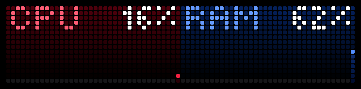

# Host Load

Live CPU and RAM graphs of your computer on the front screen of a [BUSY Bar](https://busy.bar).



CPU on the left, RAM on the right. Each half shows the current value and a graph that scrolls right
to left, one column per sample. The numbers come from [Glances](https://nicolargo.github.io/glances/),
running on your computer, which the bar reads over Wi-Fi.

## Install

You need:

- a BUSY Bar on firmware **1.3.1 or newer**;
- a Mac, Windows PC or Linux computer that the bar can reach: either **plugged into it by USB-C**, or
  on the **same network** as the bar's Wi-Fi.

Plugging the bar in is the surest way: it is found instantly, no password is asked, and the bar can
read the computer over the cable even when the two are on different networks. Then run the installer.

**macOS** — open Terminal and paste:

```bash
curl -fsSL https://raw.githubusercontent.com/mrlunev/busybar-host-load/main/install.sh | bash
```

**Windows** — open PowerShell and paste:

```powershell
irm https://raw.githubusercontent.com/mrlunev/busybar-host-load/main/install.ps1 | iex
```

**Linux** — in a terminal:

```bash
curl -fsSL https://raw.githubusercontent.com/mrlunev/busybar-host-load/main/install.sh | bash
```

Prefer clicking? Download the repository (**Code → Download ZIP**), unzip it, and double-click
`Install-macOS.command` or `Install-Windows.bat`. The first time, macOS may refuse to open a downloaded
script: allow it in **System Settings → Privacy & Security → Open Anyway**. Windows may show
"Windows protected your PC": click **More info → Run anyway**.

That is all. In a minute the graphs are on the bar.

### What the installer does

1. Installs [uv](https://docs.astral.sh/uv/) if it is not there yet. Glances runs on the Python
   already on your computer when it is version 3.10 to 3.14; only if there is none does uv download
   Python 3.12 for it, so nothing has to be installed beforehand.
2. Installs Glances 4 into its own environment and starts it at every login, serving **only CPU and
   memory** on port 61208 — no process list, no disks, no network details.
3. Opens port 61208 for your local network if the firewall needs it. Windows and macOS (only when its
   firewall is on) ask for permission first. On Windows this happens before Glances first starts, so
   the "Allow access?" prompt never appears; Block rules an earlier prompt left on that Python are
   removed, because they would override the new rules.
4. Finds the bar: over USB, then on the network. With several bars around it asks which one.
5. Installs the Host Load app on the bar, writes this computer's address into the app's settings,
   launches it, and checks the bar's screen to confirm the graphs are coming in. It tries the network
   address first when the computer and the bar share a network, and the USB link (`10.0.4.21`) when
   they do not, or when the first one gives no graphs.

Running it again is safe: it updates Glances and the app and refreshes the address. Do that if your
computer gets a new IP address.

What it adds to your computer, and nothing else:

| | macOS | Windows | Linux |
| --- | --- | --- | --- |
| Glances and its log | `~/Library/Application Support/busybar-host-load` | `%LOCALAPPDATA%\busybar-host-load` | `~/.local/share/busybar-host-load` |
| Start at login | `~/Library/LaunchAgents/com.github.mrlunev.busybar-host-load.plist` | Registry: `HKCU\...\Run\BUSY Bar Host Load` | `~/.config/systemd/user/busybar-host-load.service` |
| Firewall | python allowed, if the firewall is on | Rules "BUSY Bar Host Load (Glances)": TCP 61208, local subnet, for the port and for the Python running Glances | Nothing; a hint is printed if `ufw` is installed |

## Settings

Open the bar's web interface — `http://10.0.4.20` over USB, or the bar's IP address on Wi-Fi — and go to
**Apps → Host Load**:

| Setting | What it does |
| --- | --- |
| **Computer address** | IP address of the computer running Glances; `10.0.4.21` means "over the USB cable". The installer fills it in. Add `:port` if Glances does not use 61208. |
| **Update every** | 2, 5, 10 or 30 seconds. The graph holds 36 samples, so this is also how much history you see: from about a minute to 18 minutes. |

Changes apply within ten seconds, without restarting the app. A short press of **Back** on the bar
quits the app; start it again from the bar's Apps menu or with **Start** in the web interface.

Why 2 seconds at most: Glances refreshes its REST API about every two seconds, so sampling faster would
only repeat values.

## When something is off

| The bar shows | What to do |
| --- | --- |
| `SET ADDRESS` / `IN SETTINGS` | The app has no computer address. Run the installer, or type the address in the settings. |
| `NO GLANCES` and an address | The bar cannot reach Glances at that address. Check that the computer is awake, that the address is still right (re-run the installer if the IP changed), and that the firewall allows port 61208. If the computer and the bar are on different networks, plug the bar in by USB and run the installer again: it switches to the cable. The app keeps retrying and recovers by itself. |

The installer stops with a message instead of guessing when the bar is on old firmware, is not on Wi-Fi,
or is protected with an HTTP API password (it asks for it). To install over Wi-Fi without a cable, HTTP
API access over Wi-Fi must be on: **Network → HTTP API** in the bar's web interface.

## Uninstall

Run the installer with `--uninstall`, or double-click `setup/Uninstall-macOS.command` or
`setup/Uninstall-Windows.bat`:

```bash
curl -fsSL https://raw.githubusercontent.com/mrlunev/busybar-host-load/main/install.sh | bash -s -- --uninstall
```

```powershell
& ([scriptblock]::Create((irm https://raw.githubusercontent.com/mrlunev/busybar-host-load/main/install.ps1))) -Uninstall
```

It removes the app from the bar, stops Glances, removes the login item, the firewall rule and the data
folder. If the installer was the one that installed uv, it offers to remove uv too, with the Python
versions and cache uv downloaded. A uv you had before stays.

## Manual setup

If you already run Glances or prefer to do it by hand:

1. Run Glances 4 in web server mode on the computer. Limiting it to the two plugins the app uses keeps
   everything else off the network:

   ```bash
   glances -w --disable-webui --disable-plugin all --enable-plugin cpu,mem
   ```

2. Download `app.mrlunev.hostload.tgz` from the
   [latest release](https://github.com/mrlunev/busybar-host-load/releases/latest) and install it in the
   bar's web interface: **Apps → Add app**.
3. In **Apps → Host Load**, set **Computer address** to the computer's IP address.

The installer also detects a Glances that already runs on port 61208 and uses it instead of installing
its own.

## A note on security

Glances' web server has no authentication, and anyone on your local network can read what it serves.
That is why the installer enables only the CPU and memory plugins, and why the Windows firewall rule
accepts connections from the local subnet only. Do not expose port 61208 to the internet.

## How the screen is drawn

The front display is 72×16 pixels, split into two 36-pixel halves laid out the same way: the label in the
left corner, the value in the right corner, both 1 px from the half's edges on rows 0–4, and the graph
below. 100% is row 6 and 0% is the bottom row, so the graph never touches the text.

The firmware's draw API has no line primitive, so each graph is an `xpmbitmap` built pixel by pixel: a
1 px line with vertical segments bridging jumps between neighbouring samples, a filled area underneath,
and transparent pixels elsewhere so the half's background shows through. XPM2 allows 32 colours; a
ten-step area gradient plus a ten-step line gradient plus transparent comes to 21. Each background is a
`rectangle` with a vertical gradient. Only elements that changed are sent to the display on each tick.

| | CPU | RAM |
| --- | --- | --- |
| Background | `#4e000c` → `#000000` | `#052059` → `#000000` |
| Area under the line | `#890d1f` → `#280006` | `#14419a` → `#010d2f` |
| Line | `#ff5c74` → `#ee1939` | `#659aff` → `#3378ff` |
| Label | `#ff5c74` | `#659aff` |
| Value | `#ffffff` | `#ffffff` |

## Development

Requires Node 24 (Node 26 is not supported).

```bash
npm install
npm run typecheck
npm run build                                  # dist/app.mrlunev.hostload.tgz
npm run app:install                            # install on the bar connected over USB
npm run app:run
```

Over Wi-Fi add `-- --addr <bar-ip>` (and `--password <password>` if the bar has one). Do not pass
`--addr` to `npm run build`: it changes the address the app itself talks to, which must stay `localhost`.

Run from a checkout, the installer uses the package in `dist/` when there is one, so
`npm run build && ./install.sh` deploys a local build. `--bar <address>` and `--package <file>` override
discovery and the package.

| Path | What it is |
| --- | --- |
| `src/main.ts` | Entry point: polling, redrawing, the **Back** button. |
| `src/config.ts` | Reads the settings and parses the computer address. |
| `src/glances.ts` | Glances client: `GET /api/4/cpu` → `total`, `GET /api/4/mem` → `percent`. |
| `src/graph.ts` | Renders one half's graph as XPM2. |
| `src/screen.ts` | Display elements for the graphs and for the message screen. |
| `src/layout.ts` | Screen geometry and palette. |
| `src/appmeta/` | Manifest, settings schema, icons. |
| `install.sh`, `install.ps1` | Installer launchers: make sure uv is there, then run the setup script. |
| `setup/hostload_setup.py` | The installer itself; Python standard library only. |

Releases are built by GitHub Actions: push a tag equal to the version in `src/appmeta/manifest.json`
(e.g. `1.0.0`) and the workflow attaches `app.mrlunev.hostload.tgz` to the release.

## License

[MIT](LICENSE)
